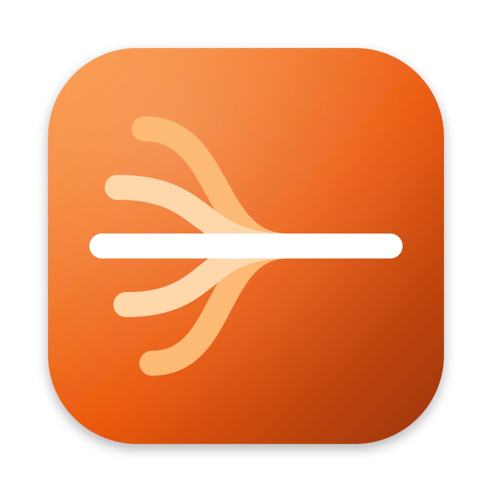

# Mixdown

Mixdown records your microphone, whatever your Mac is playing (such as a call or a video), or
both at once, turns the speech into text, and saves it as a Markdown note. It has a small main
window and also lives in your Mac's menu bar.
Everything happens on your Mac. Your audio never leaves it.

## Using Mixdown

Mixdown's window has a sidebar with **Record** at the top and your recordings below it, in
collapsible sections by day. The cog above the sidebar, next to the sidebar button, opens Settings.

1. Open Mixdown. **Record** shows the big record button and what the next recording uses:
   microphone, system audio, speech model, language and notes folder.
2. The first time, click **Download Model** and wait for it to finish (see
   [Speech models](#speech-models)). Recording stays off until the model is on your Mac.
3. Pick your inputs in the **Recording** menu (a microphone, **System Audio**, or both), or with
   **Change…** next to the setup summary.
4. Click the red button (or press ⌘R) to record, and again to stop.

With the live model (the default), **Record** shows the words as you speak, about half a second
behind and labeled **Me** and **Others** when you record a call. That text is the note.

Soon after you stop, the note appears under **Today** in the sidebar and opens, rendered much like
Apple Notes. Click a day to fold it away, and search the sidebar to find older recordings.
**File → Open Notes Folder** and **Reveal Last Note in Finder** take you to the files.

**View → Record / Notes** (⌘1, ⌘2) switch the window's section, and **Mixdown → Settings…** (⌘,)
opens Settings. The waveform icon in the menu bar can start and stop recording and pick inputs
without the window, and has **Settings…** too. Recording carries on there if
you close the window; **Open Mixdown** in that menu, **Window → Mixdown** (⌘0) or the Dock icon
brings it back.

The first time, macOS asks for permission: **Microphone** to record your voice, or **System
Audio Recording** to record what your Mac plays. If system audio comes out silent, check that
Mixdown is on under System Settings › Privacy & Security › Screen & System Audio Recording ›
System Audio Recording Only. macOS gives a muted recording rather than an error when it's off.

## Recording calls

Turn on both your microphone and **System Audio** to capture both sides of a call: your voice
through the microphone, everyone else through your Mac's speakers. Choosing a microphone in the
menu replaces the current one; choosing it again turns it off, as long as System Audio stays on.

Each input is recorded and transcribed on its own, then the lines are merged by time and labeled
**Me** and **Others**. Change the names under **Settings → Recording**.

Wear headphones if you can. Without them your microphone also hears the other people, and while
Mixdown drops lines it recognizes as that echo, it can't catch all of it.

## Speech models

Choose a model under **Settings → Transcription**, in one of two categories:

- **Live** transcribes while you record, so the note is ready when you stop. The audio isn't kept,
  so an hours-long meeting takes no more memory than a short one.
- **Offline** transcribes the whole recording once you stop. The audio is kept in memory until
  then. It's more accurate, and MOSS can tell speakers apart.

A model is downloaded once, from **Download
Model** in the window, the Recording menu or Settings, and the time left shows next to the menu bar icon. After
switching models, download the new one before recording. **Cancel Download** in the menu (or **Cancel** in Settings) stops
it; files already fetched are kept, so the next download picks up where it left off.
To free up disk space, select a model under **Settings → Transcription** and choose **Delete**;
you'll need to download it again before recording with it.

| Category | Model | Size | Good for |
| -------- | ----- | ---- | -------- |
| Live (default) | Nemotron 3.5 ASR Streaming 0.6B | ~540 MB | Long meetings, text as you speak |
| Offline · Low | Qwen3-ASR 0.6B | ~0.9 GB | Fast, everyday notes |
| Offline · High | Qwen3-ASR 1.7B | ~2.3 GB | Better accuracy, on Macs with 24 GB+ memory |
| Offline · Speakers | MOSS Transcribe Diarize 0.9B | ~1 GB | Meetings: labels who is speaking |

With MOSS, speaker numbers start over every 10 minutes, so "Speaker 1" may be someone else
later in a long recording. When recording a call, MOSS numbers the speakers within each input,
e.g. "Me (Speaker 1)" and "Me (Speaker 2)" for two people at your Mac, and "Others (Speaker 1)"
and "Others (Speaker 2)" for two people on the call. The other models don't tell speakers apart,
so their lines are just labeled "Me" and "Others".

The live model also drops the echo of the call from your microphone's lines in the note, but the
text on screen still shows it while you record.

## Notes

Notes are saved to `~/Documents/Mixdown` unless you pick another folder under
**Settings → General**. A note looks like this:

```markdown
---
title: "Recording Oct 13, 2026 at 2:02 PM"
created: 2026-10-13T14:02:11+02:00
duration: 754
source: "MacBook Pro Microphone"
source_kind: microphone
engine: "MOSS Transcribe Diarize 0.9B"
speakers: ["Speaker 1", "Speaker 2"]
tags: [mixdown]
---

# Recording Oct 13, 2026 at 2:02 PM

## Transcript

**[00:00:00] Speaker 1:** Okay, let's get started with the weekly sync.

**[00:00:04] Speaker 2:** First up, the release timeline…
```

A call recorded from a microphone and system audio lists both sources and labels each line:

```markdown
sources: ["MacBook Pro Microphone", "System Audio"]
source_kinds: [microphone, systemAudio]
speakers: ["Me", "Others"]
…
**[00:00:00] Me:** Morning, everyone.

**[00:00:03] Others:** Let's look at the release plan.
```

## Building from source

You need a Mac with Apple Silicon running macOS 15 or later, Xcode, and
[Homebrew](https://brew.sh).

```sh
make bootstrap   # one-time setup
make run         # build and launch
make test        # run the tests
make clean       # quit Mixdown, delete all build output and refresh the Dock icon
```

To sign the app with your Apple developer account, set `DEVELOPMENT_TEAM` in `project.yml`.

The speech engine sits behind one interface (`TranscriptionEngine`), so it can be replaced
by changing a single line in `Mixdown/App/AppEnvironment.swift`.

## License

MIT. See [LICENSE](LICENSE).
